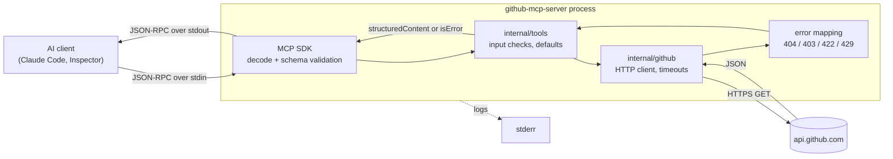

# github-mcp-server

An [MCP](https://modelcontextprotocol.io) server, written in Go, that lets AI assistants read public GitHub data through four tools.

| Tool | What it does | GitHub endpoint |
|---|---|---|
| `get_github_user` | Profile of a user or organization: name, bio, company, followers, repo count | `GET /users/{username}` |
| `get_github_repo` | One repository: description, stars, forks, watchers, open issues, language, topics, license | `GET /repos/{owner}/{repo}` |
| `list_user_repos` | A user's public repositories, page by page, with optional sorting | `GET /users/{username}/repos` |
| `search_repositories` | Search with GitHub's query syntax (`language:go stars:>100 ...`) | `GET /search/repositories` |

All tools are read-only. They are built on the official Go SDK, [`github.com/modelcontextprotocol/go-sdk`](https://github.com/modelcontextprotocol/go-sdk) v1.8.0, and talk to clients over **stdio** by default, or over **streamable HTTP** with `-http` for remote clients such as ChatGPT.

## How a request flows



1. The client starts `bin/github-mcp-server` and writes JSON-RPC to its **stdin**.
2. The SDK decodes the call and **validates the arguments** against the tool's JSON Schema (required fields, types, enums, min/max). Invalid calls never reach our code.
3. The tool handler in `internal/tools` trims and checks input (username format, page limits) and applies defaults.
4. `internal/github` sends the HTTPS request, with a 10s timeout, the caller's `context`, the GitHub API headers and an optional token.
5. Errors are classified (not found, rate limited, validation failed) and rewritten as messages an AI can act on.
6. The result goes back on **stdout** as `structuredContent` plus a text copy, or as a tool error with `isError: true`.

Logs go to **stderr** only: anything else written to stdout would corrupt the protocol.

## Project layout

```
github-mcp-server/
├── cmd/
│   ├── server/          MCP server: main.go (wiring) + main_test.go (end-to-end MCP tests)
│   └── ghuser/          dev tool: try the GitHub client from the terminal, no MCP
├── internal/
│   ├── github/          GitHub REST client — knows nothing about MCP
│   │   ├── client.go      Client, Options, shared get(), paging helpers
│   │   ├── errors.go      APIError, IsNotFound, IsRateLimited
│   │   ├── models.go      User, Repository, License, search result
│   │   ├── users.go       GetUser
│   │   ├── repos.go       GetRepo, ListUserRepos
│   │   ├── search.go      SearchRepositories
│   │   └── *_test.go      tests against an httptest fake server
│   └── tools/           MCP tools — turn MCP input into client calls and back
│       ├── register.go    Register(server, client): adds every tool
│       ├── user.go        get_github_user
│       ├── repository.go  get_github_repo, list_user_repos
│       ├── search.go      search_repositories
│       ├── validate.go    input checks and defaults
│       ├── schema.go      adds enums and ranges to inferred schemas
│       ├── errors.go      GitHub error → message for the AI
│       └── *_test.go
├── .mcp.json            registers the server with Claude Code for this folder
├── go.mod / go.sum      module name, dependencies and their checksums
└── README.md
```

Dependencies point one way only: `cmd/server` → `internal/tools` → `internal/github`.

## Requirements

- Go 1.27 or newer (`go version`)
- Node.js, only for MCP Inspector (`node --version`)

## Build and run

Install the latest version without cloning:

```bash
go install github.com/MuhammadAmas/github-mcp-server/cmd/server@latest
```

Go names the binary after its folder, so this installs it as `server` in `$(go env GOPATH)/bin` (usually `~/go/bin/server`). Use that full path as the `command` in client configs.

Or build from a clone:

```bash
git clone https://github.com/MuhammadAmas/github-mcp-server.git
cd github-mcp-server
go build -o bin/github-mcp-server ./cmd/server
```

The server is started **by an MCP client**, not by hand. Run on its own, it prints `starting on stdio` to stderr and waits for JSON on stdin; Ctrl+C stops it.

### Environment variables (optional)

| Variable | Default | Purpose |
|---|---|---|
| `GITHUB_TOKEN` | *(none)* | A GitHub token. Raises limits from 60 to 5,000 requests/hour (search: 10 → 30/minute). Public data needs no scopes. Never commit it. |
| `GITHUB_API_URL` | `https://api.github.com` | API base URL, e.g. for GitHub Enterprise Server (`https://ghe.example.com/api/v3`). |

## Use it from an AI client

### Claude Code
`.mcp.json` in this folder registers the server:

```json
{
  "mcpServers": {
    "github-mcp-server": {
      "type": "stdio",
      "command": "/Users/apple/Downloads/personal/github-mcp-server/bin/github-mcp-server",
      "args": []
    }
  }
}
```

Start a **new** Code session whose folder is `github-mcp-server`, approve the server when asked, then try *"What are the most-starred Go MCP repositories? Show details for the top one."*

To pass a token, add `"env": { "GITHUB_TOKEN": "..." }` to a copy of this entry in your **personal** config, not in this shared file.

### Claude Desktop (Chat)
Settings → Developer → Edit Config, then add the same entry under a top-level `"mcpServers"` key (without `"type"`). Quit Claude completely (Cmd+Q) and reopen it. Server logs: `~/Library/Logs/Claude/mcp-server-github-mcp-server.log`.

**After every code change:** rebuild, then start a new session or restart the app. Clients keep the old process running.

### Other local clients
Any app that starts local MCP servers can use the same binary path:

| App | Config file | Top-level key |
|---|---|---|
| Cursor | `~/.cursor/mcp.json` or `.cursor/mcp.json` | `mcpServers` |
| Gemini CLI | `~/.gemini/settings.json` | `mcpServers` |
| Windsurf, Cline, LM Studio | the app's `mcp.json` | `mcpServers` |
| VS Code (Copilot agent mode) | `.vscode/mcp.json` | `servers`, with `"type": "stdio"` |
| Codex CLI | `.codex/config.toml` (included) or `~/.codex/config.toml` | `[mcp_servers.github-mcp-server]` |

## HTTP mode (remote clients such as ChatGPT)

ChatGPT runs in OpenAI's cloud: it can't start a program on your machine, and it only connects to a public `https://` URL. Start the server in HTTP mode instead:

```bash
./bin/github-mcp-server -http 127.0.0.1:8080
```

It serves MCP at `http://127.0.0.1:8080/mcp` using the streamable HTTP transport and stops cleanly on Ctrl+C. Without `-http` the server uses stdio, as before. Idle sessions are closed after 30 minutes.

### Connect ChatGPT

1. Run the server as above.
2. In a second terminal, give it a public HTTPS address with a tunnel. Rewriting the `Host` header is required (see the warning below):
   ```bash
   ngrok http 8080 --host-header=rewrite
   ```
   With Cloudflare instead: `cloudflared tunnel --url http://127.0.0.1:8080 --http-host-header 127.0.0.1:8080`.
3. In ChatGPT, turn on **Developer Mode** (Settings → Connectors or Apps → Advanced; menu names vary by account). It needs a paid plan.
4. Choose **Add custom MCP server**, paste the tunnel URL **with `/mcp` at the end** (e.g. `https://abc123.ngrok-free.app/mcp`), and choose no authentication.
5. In each chat, enable the server from the **+** menu, then ask e.g. *"Use github-mcp-server to show details of golang/go."*

> **Host header:** the SDK protects local servers from DNS rebinding by refusing requests that reach `127.0.0.1` with a non-local `Host` header. A tunnel that forwards `Host: abc123.ngrok-free.app` unchanged gets `403 Forbidden: invalid Host header`. That's why step 2 rewrites it.

> **Security:** the server has no authentication. Anyone with the tunnel URL can call its tools. They only read public data, but they use your `GITHUB_TOKEN`'s rate limit if one is set. Stop the tunnel when you're done, and don't share the URL.

The same URL works for other remote clients, such as OpenAI's API (`"type": "mcp"` tool with `server_url`) or Claude's MCP connector.

### Test HTTP mode locally

```bash
npx @modelcontextprotocol/inspector
```

In the Inspector, set **Transport Type** to *Streamable HTTP* and **URL** to `http://127.0.0.1:8080/mcp`, then **Connect**.

## Test with MCP Inspector

```bash
npx @modelcontextprotocol/inspector ./bin/github-mcp-server
```

Open the printed `http://127.0.0.1:6274?...` link (it includes an auth token), then **Connect** → **Tools** → **List Tools**. Pick a tool, fill in the arguments, and click **Run Tool**.

Things to try:
- `get_github_user` with `octocat` → a profile; with `bad/name` → a validation error, with no GitHub call.
- `list_user_repos` with `sort` = `stars` → rejected by the schema enum. The allowed values are `created`, `updated`, `pushed` and `full_name`.
- `search_repositories` with `query` = `mcp language:go`, `sort` = `stars`.

Scriptable CLI mode:
```bash
npx @modelcontextprotocol/inspector --cli ./bin/github-mcp-server --method tools/call --tool-name get_github_user --tool-arg username=octocat
```

## Automated tests

```bash
go test ./...
go test ./... -race -cover
go test ./internal/tools -run TestSearchRepositories -v
```

The tests never call the real GitHub. Each test starts an `httptest` server that pretends to be GitHub:

| Level | File | What it proves |
|---|---|---|
| HTTP client | `internal/github/*_test.go` | URLs, query encoding, headers, token, JSON decoding, 404/403/422/429/500, timeout, cancellation |
| Tool logic | `internal/tools/*_test.go` | validation, defaults, field mapping, `omitempty`, nil license, error messages, no API call on bad input |
| End to end | `cmd/server/main_test.go` | a real MCP client talks to the real server over in-memory transports and over HTTP: tool listing, schema validation, structured results, tool errors, the `Host` header check |

Current result: all packages pass with `-race`; combined coverage is about 87%.

## Debugging

- **Logs:** use `log.Printf(...)`, which goes to stderr. Inspector shows it, and Claude Desktop writes it to the log file above. Never use `fmt.Println` in the server.
- **Try the client without MCP:** `go run ./cmd/ghuser torvalds`
- **GoLand, the easy way:** open any `*_test.go` file and click the green ▶ in the gutter → **Debug**. Breakpoints in handlers and the client will be hit, with no stdio involved.
- **GoLand, the live server:** build with debug info using `go build -gcflags="all=-N -l" -o bin/github-mcp-server ./cmd/server`, start Inspector with it, then in GoLand use **Run → Attach to Process…** and pick `github-mcp-server`. Set breakpoints, then run a tool in Inspector.

### Common problems

| Symptom | Fix |
|---|---|
| `go: go.mod file not found` | You're not in the project folder: `cd ~/Downloads/personal/github-mcp-server` |
| Client shows old tools or old behaviour | Rebuild, then start a new session or reconnect |
| Inspector/Claude: connection closed right away | Something wrote to stdout; use `log` (stderr) |
| `GitHub rate limit exceeded ... resets at ...` | Wait, or set `GITHUB_TOKEN`. Search has a separate 10/minute limit |
| `spawn ... ENOENT` | The binary path is wrong or not built. Use an absolute path in client configs |
| `403 Forbidden: invalid Host header` in HTTP mode | Your tunnel forwards the public hostname. Use `ngrok http 8080 --host-header=rewrite` |
| ChatGPT can't connect or lists no tools | Check the URL ends in `/mcp`, the server and tunnel are both running, and the URL is `https://` |

## Adding a tool

1. Add the API call to `internal/github`, plus a test with a fake server.
2. Create `internal/tools/<name>.go` with an input struct, an output struct, a logic function `Xxx(ctx, gh, in)`, and `AddXxxTool(server, gh)`.
3. Call it from `tools.Register` in `register.go`.
4. Add tests, run `go test ./... -race`, rebuild, and try it in Inspector.

## How it was built

```mermaid
flowchart LR
    P1["1 · Setup<br/>Go, Node, go mod init"] --> P2["2 · Minimal MCP<br/>add_numbers over stdio"]
    P2 --> P3["3 · GitHub client<br/>timeouts, context, errors"]
    P3 --> P4["4 · First tool<br/>get_github_user"]
    P4 --> P5["5 · More tools<br/>repo, list, search"]
    P5 --> P6["6 · Refactor<br/>Register, users.go, run()"]
    P6 --> P7["7 · Tests<br/>httptest + in-memory MCP"]
    P7 --> P8["8 · Verify<br/>build, Inspector, README"]
```


